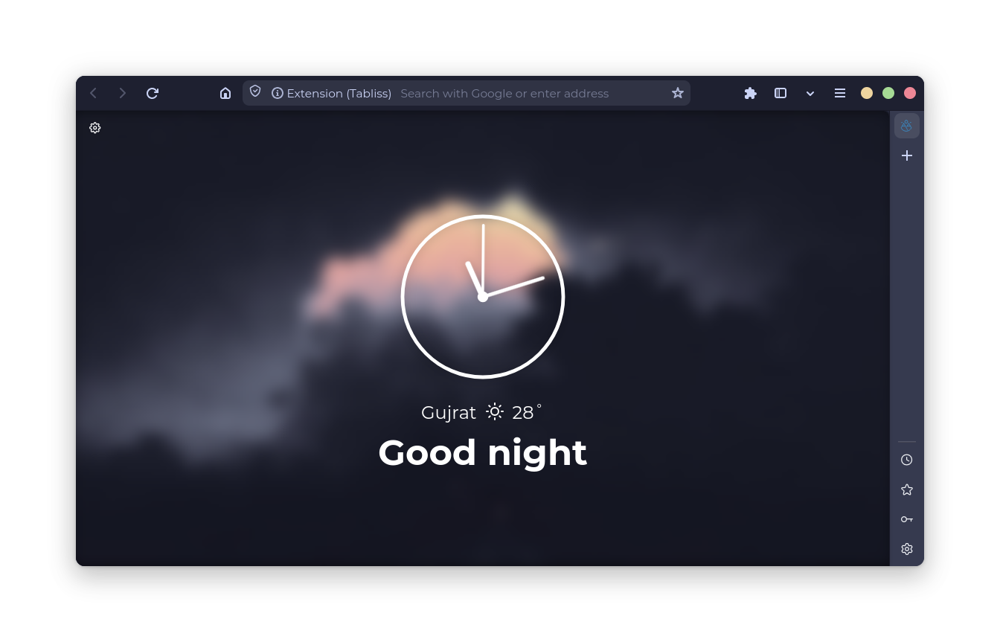

# Firefox GNOME Theme (Catppuccin Edition)

A GNOME Adwaita theme for Firefox with harmonized Catppuccin color schemes, compatible with Firefox 130+ (including modern Firefox releases).



## Features

- **Catppuccin Palette**: Macchiato for dark/OLED modes and Latte for light mode.
- **Harmonized Accents**: Consistent Catppuccin accent colors across tab highlights, container tabs, tab groups, address bar (URL bar focus ring, selection, matched URLs), and context menus.
- **GNOME Adwaita Interface**: Native GNOME headerbar styling, tab layout, popovers, and dialogs.
- **Window Controls (CSD)**: Colored window controls with Catppuccin accents (close: red, minimize: yellow, maximize/restore: green).
- **Firefox 130+ Compatible**: Updated for recent Firefox changes including revised URL bar tokens, modern tab strip layouts, and updated panel selectors.

---

## Installation

### Automated Install (Recommended)

The automated script automatically discovers your active Firefox profile across standard, Flatpak, Snap, LibreWolf, Floorp, and Waterfox installations, and symlinks `userChrome.css`, `userContent.css`, and theme assets into your profile's `chrome/` directory:

1. Clone this repository:
   ```bash
   git clone https://github.com/ddroid/firefox-theme.git
   cd firefox-theme
   ```

2. Run the automated installer:
   ```bash
   ./install.sh
   ```

   *Optional flags:*
   - `-f <path>`: Specify a custom Firefox folder (e.g. `~/.mozilla/firefox`)
   - `-p <name>`: Install to a specific profile name or directory
   - `-a`, `--all`: Install to all discovered Firefox profiles

3. Restart Firefox.

### Manual Install

1. Find your Firefox profile directory:
   - In Firefox, navigate to `about:support`.
   - Under **Application Basics**, locate **Profile Directory** (or **Profile Folder**) and click **Open Directory** (or **Open Folder**).

2. Inside your profile directory, create a `chrome` directory if it does not already exist:
   ```bash
   mkdir -p chrome
   ```

3. Create symbolic links to this repository's files inside `<profile_dir>/chrome/`:
   ```bash
   ln -s /path/to/firefox-theme/userChrome.css <profile_dir>/chrome/userChrome.css
   ln -s /path/to/firefox-theme/userContent.css <profile_dir>/chrome/userContent.css
   ln -s /path/to/firefox-theme/theme <profile_dir>/chrome/theme
   ln -s /path/to/firefox-theme/icon.svg <profile_dir>/chrome/icon.svg
   ```

4. Enable required preferences in `<profile_dir>/user.js` (or see [Required Firefox Preferences](#required-firefox-preferences)):
   ```javascript
   user_pref("toolkit.legacyUserProfileCustomizations.stylesheets", true);
   user_pref("svg.context-properties.content.enabled", true);
   ```

5. Restart Firefox completely.

---

## Required Firefox Preferences

Starting in Firefox 69, Mozilla disabled loading `userChrome.css` and `userContent.css` by default to improve browser startup performance. You must enable custom stylesheet support:

- `toolkit.legacyUserProfileCustomizations.stylesheets` = `true` *(Enables custom CSS loading)*
- `svg.context-properties.content.enabled` = `true` *(Enables SVG icon color theming)*
- `browser.uidensity` = `0` *(Default density)*

The `install.sh` script configures these automatically in your profile's `user.js`.

---

## Troubleshooting: `toolkit.legacyUserProfileCustomizations.stylesheets`

If the theme does not appear after restarting Firefox, follow these troubleshooting steps:

### 1. Verify the preference in `about:config`
1. Open a new tab in Firefox and navigate to `about:config`.
2. Click **Accept the Risk and Continue** when prompted.
3. In the search box, paste:
   ```text
   toolkit.legacyUserProfileCustomizations.stylesheets
   ```
4. Verify that the value is set to **`true`**.
5. If it is set to `false`, double-click or click the toggle button (⇄) to set it to **`true`**.
6. Do the same for `svg.context-properties.content.enabled` (must also be `true`).
7. Completely close Firefox (`Ctrl+Q` or menu -> Quit) and restart it.

### 2. Verify the Active Profile Directory
A common cause of stylesheets not loading is linking them into an inactive or secondary profile:
1. Open Firefox and go to `about:support`.
2. Look for **Profile Directory** and click **Open Directory**.
3. Verify that the opened directory contains a `chrome/` subfolder with `userChrome.css` and `userContent.css` (either as files or valid symlinks).
4. Run `ls -l chrome/` inside the profile folder in a terminal to confirm symlinks are not broken:
   ```bash
   cd "$(firefox-profile-path)/chrome"
   ls -la
   ```
   If symlinks point to a non-existent or moved folder, re-run `./install.sh`.

### 3. Clear Firefox Startup Cache
Firefox aggressively caches compiled stylesheets and UI state:
1. Open `about:support`.
2. Under **Try clearing the startup cache**, click **Clear startup cache...**.
3. Confirm by clicking **Restart**.

### 4. Flatpak and Snap Installations
If you are using Flatpak or Snap, profiles are stored in sandboxed directories:
- **Flatpak**: `~/.var/app/org.mozilla.firefox/.mozilla/firefox/`
- **Snap**: `~/snap/firefox/common/.mozilla/firefox/`

The `install.sh` script checks these locations automatically. If using a custom flatpak override or container, specify the path explicitly:
```bash
./install.sh -f ~/.var/app/org.mozilla.firefox/.mozilla/firefox
```

### 5. Custom Overrides
To apply your own CSS overrides without modifying the tracked theme files, edit:
- `customChrome.css` in your profile's `chrome/` directory for browser UI
- `customContent.css` in your profile's `chrome/` directory for web content

These files are preserved across theme updates.

---

## Updates

To update to the latest version of the theme:
```bash
cd firefox-theme
git pull
```
Because the theme files are symlinked, changes apply immediately upon restarting Firefox.

---

## Uninstall

To remove the theme:
1. Remove the linked items from your profile's `chrome` directory:
   ```bash
   rm -rf <profile_dir>/chrome/userChrome.css <profile_dir>/chrome/userContent.css <profile_dir>/chrome/theme <profile_dir>/chrome/icon.svg
   ```
2. (Optional) Set `toolkit.legacyUserProfileCustomizations.stylesheets` back to `false` in `about:config`.
3. Restart Firefox.
